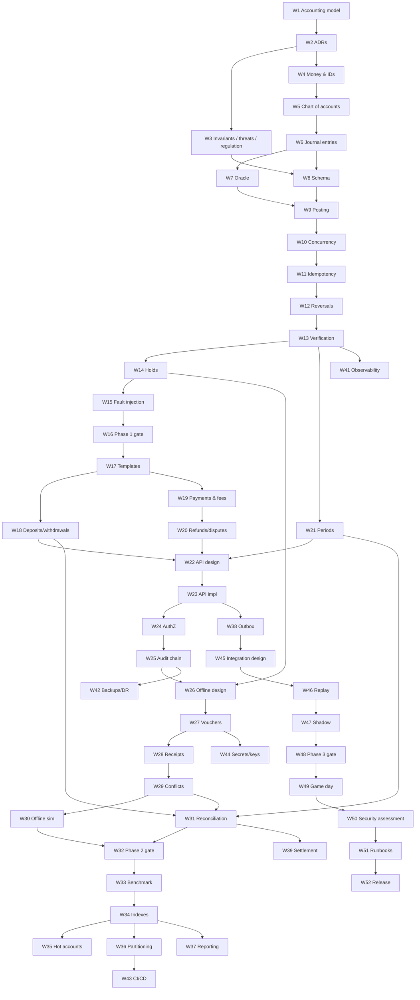

# Mezgeb Engineering Roadmap: 52 Weeks

The goal is a professionally engineered, secure, reliable, auditable
double-entry ledger that becomes Atronsa's core accounting infrastructure,
and an open-source project in its own right.

| Document | Contents |
|---|---|
| [architecture.md](architecture.md) | Stack evaluation, system shape, data model, the 10 architectural questions with alternatives, standards |
| [phase-1.md](phase-1.md) | Weeks 1–16: accounting model and core engine |
| [phase-2.md](phase-2.md) | Weeks 17–32: operations, API, security, offline, reconciliation |
| [phase-3.md](phase-3.md) | Weeks 33–48: scale, operations, Atronsa integration, shadow mode |
| [finalization.md](finalization.md) | Weeks 49–52: game day, security assessment, runbooks, release |
| [strategies.md](strategies.md) | Testing, security, database and operations strategies; readiness checklist |

---

## How to use this roadmap

- **A "week" is a work unit of about 15–20 focused hours**, not a calendar
  week. At weekends-only pace, expect 52 units to take 12–18 calendar months.
  That is fine, because correctness comes before the date.
- Each week closes only when its **Exit Gate** is demonstrated and the evidence
  is committed under `docs/evidence/`. If a gate fails, the week repeats;
  later weeks don't start.
- **Weeks 10, 15, 26, 28–30, 35 and 36 are the most likely to overrun.**
  Budget 1.5–2× for each. Week 40 has deliberate spare capacity.

## Phases and milestones

| Milestone | Week | Evidence |
|---|---|---|
| M0 Model agreed | 3 | Worked entries, ADRs, invariants v1, threat model v0 |
| M1 Engine correct | 16 | Tag `v0.1.0-engine`: concurrency, idempotency, holds, reversals, verify, chaos clean |
| M2 Functional and secured | 32 | Tag `v0.2.0-functional`: all operations, secured API, audit chain, offline simulator clean |
| M3 Shadow on live traffic | 48 | Tag `v0.9.0-rc-shadow`: targets met, DR proven, 14 clean shadow days |
| M4 Release candidate | 52 | Tag `v1.0.0-rc.1`, readiness checklist with evidence, cutover rehearsed |

## Architectural development sequence

Model (W1–3) → types (W4–6) → oracle (W7) → schema (W8) → posting (W9) →
concurrency (W10) → idempotency (W11) → corrections (W12) → verification (W13)
→ holds (W14) → failure proof (W15) → templates (W17) → money operations
(W18–20) → periods (W21) → API (W22–23) → access control (W24) → audit (W25) →
offline (W26–30) → reconciliation (W31) → security gate (W32) → performance
(W33–37) → integration plumbing (W38–40) → operations (W41–44) → migration
(W45–48) → finalization (W49–52).

## Dependency map

## Estimated complexity

**Very high overall.** The accounting core (Phase 1) is high complexity.
Offline settlement (W26–30) is the hardest part and has no off-the-shelf
reference. The Atronsa migration (W45–48) carries the most operational risk.

## Is 52 weeks enough?

**For a release candidate with evidence: yes, tightly, at 15–20 hours per
unit.** For *going live*: not on its own. Going live also needs ≥30 clean
shadow days, an external review and possibly regulatory sign-off, which
plausibly adds 1–3 months beyond Week 52. The roadmap does not shorten any
gate to hit the date.

## Most difficult engineering challenges

1. Concurrency correctness under contention (W10, W35).
2. Offline protocol: cloned devices, gaps and late receipts with sound accounting (W26–30).
3. Partitioning a live, append-only, uniquely-constrained schema (W36).
4. Proving crash safety rather than assuming it (W15, W49).
5. Migrating live money with zero unexplained differences (W45–48).

## Where a single developer will struggle

- **Self-review blindness** on security and accounting. Plan external eyes (below).
- **Operations on call**: one person cannot be on call permanently. Before go-live, arrange at least one more person who can follow the runbooks.
- **Sustained pace**: protect Atronsa's main work; if a week slips, the plan slips. Don't skip gates.
- **Hardware coupling**: offline depends on card and phone capabilities being decided by the tap-to-pay work.

## Specialist review needed

| Area | Reviewer | When |
|---|---|---|
| Chart of accounts, posting rules, reports | Accountant / auditor | W1, W21, W37 |
| Offline cryptographic protocol | Security engineer with crypto background | W26, W50 |
| API and application security | Penetration tester | W50 |
| Schema, locking, partitioning, backups | Experienced PostgreSQL DBA | W8, W10, W36, W42 |
| Regulatory applicability | Ethiopian fintech legal advisor | W3, before go-live |

## Research before implementation

- NBE rules for stored value, offline limits, record retention and reporting (W3).
- Card chip capabilities: secure element, counter, signing (before W26; affects current card work).
- Android Keystore/StrongBox attestation reliability on devices common in Ethiopia (W26).
- PostgreSQL MVCC, explicit locking, isolation and WAL chapters (before W8–W10).
- Partner bank statement formats (before W31).

## Never compromise

1. Every entry balances, enforced in types, the engine *and* the database.
2. History is never modified. Corrections are new entries.
3. Idempotency commits in the same transaction as the money movement.
4. No float money; no silent rounding.
5. The ledger is the source of truth, and caches never override it.
6. Offline spending is always backed by reserved escrow.
7. No manual money movement without maker-checker and an audit event.
8. No production claim without evidence.
