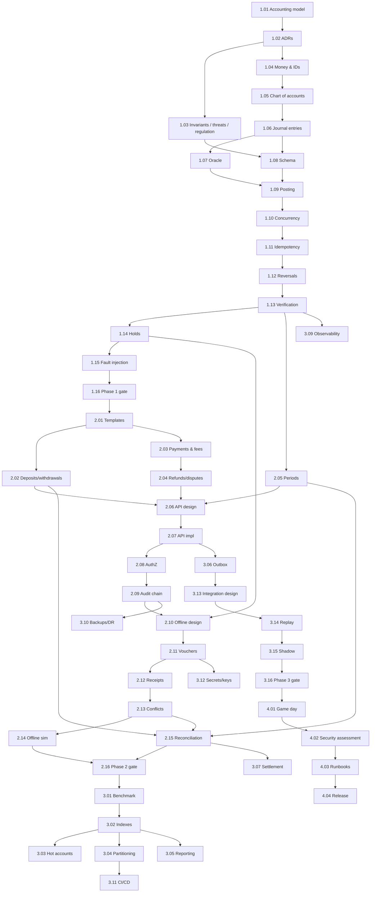

# Mezgeb Engineering Roadmap

The goal is a professionally engineered, secure, reliable, auditable
double-entry ledger: an open-source project in its own right, ready to
become the core accounting infrastructure of production payment applications.

## Contents

| Folder / file | Steps | Contents |
|---|---|---|
| [phase-1-core-engine/](phase-1-core-engine/README.md) | 1.01–1.16 | Accounting Model and Core Engine |
| [phase-2-operations-and-security/](phase-2-operations-and-security/README.md) | 2.01–2.16 | Financial Operations, API, Security and Offline |
| [phase-3-scale-and-integration/](phase-3-scale-and-integration/README.md) | 3.01–3.16 | Scale, Operations and Client Integration |
| [phase-4-finalization/](phase-4-finalization/README.md) | 4.01–4.04 | Finalization |
| [strategies.md](strategies.md) | | Testing, security, database and operations strategies; readiness checklist |
| [../architecture.md](../architecture.md) | | Stack evaluation, system shape, data model, the 10 architectural questions |

## How the roadmap works

- The work is divided into **52 steps in four phases**. A step ID such as
  `2.05` means phase 2, step 5. Each step has its own file with an objective,
  tasks, tests, deliverables and an **Exit Gate**.
- Steps run in dependency order. A step closes only when its exit gate is
  demonstrated and the evidence is committed under `docs/evidence/`. If a gate
  fails, the step repeats; later steps don't start.
- Each step is sized at about **15–20 focused hours** of work.
- **Steps 1.10, 1.15, 2.10, 2.12–2.14, 3.03 and 3.04 are the most likely to
  overrun.** Budget 1.5–2× for each. Step 3.08 has deliberate spare capacity.

## Milestones

| Milestone | Reached after | Evidence |
|---|---|---|
| M0 Model agreed | 1.03 | Worked entries, ADRs, invariants v1, threat model v0 |
| M1 Engine correct | 1.16 | Tag `v0.1.0-engine`: concurrency, idempotency, holds, reversals, verify, chaos clean |
| M2 Functional and secured | 2.16 | Tag `v0.2.0-functional`: all operations, secured API, audit chain, offline simulator clean |
| M3 Shadow on live traffic | 3.16 | Tag `v0.9.0-rc-shadow`: targets met, DR proven, 14 clean shadow days |
| M4 Release candidate | 4.04 | Tag `v1.0.0-rc.1`, readiness checklist with evidence, cutover rehearsed |

## Development sequence

Model (1.01–1.03) → types (1.04–1.06) → oracle (1.07) → schema (1.08) → posting (1.09) →
concurrency (1.10) → idempotency (1.11) → corrections (1.12) → verification (1.13)
→ holds (1.14) → failure proof (1.15) → templates (2.01) → money operations
(2.02–2.04) → periods (2.05) → API (2.06–2.07) → access control (2.08) → audit (2.09) →
offline (2.10–2.14) → reconciliation (2.15) → security gate (2.16) → performance
(3.01–3.05) → integration plumbing (3.06–3.08) → operations (3.09–3.12) → migration
(3.13–3.16) → finalization (4.01–4.04).

## Dependency map

## Estimated complexity

**Very high overall.** The accounting core (Phase 1) is high complexity.
Offline settlement (2.10–2.14) is the hardest part and has no off-the-shelf
reference. Migrating the first client application (3.13–3.16) carries the most operational risk.

## Most difficult engineering challenges

1. Concurrency correctness under contention (1.10, 3.03).
2. Offline protocol: cloned devices, gaps and late receipts with sound accounting (2.10–2.14).
3. Partitioning a live, append-only, uniquely-constrained schema (3.04).
4. Proving crash safety rather than assuming it (1.15, 4.01).
5. Migrating live money with zero unexplained differences (3.13–3.16).

## Where a single developer will struggle

- **Self-review blindness** on security and accounting. Plan external eyes (below).
- **Operations on call**: one person cannot be on call permanently. Before go-live, arrange at least one more person who can follow the runbooks.
- **Sustained pace**: protect your other commitments; if a step slips, the schedule slips. Don't skip gates.
- **Hardware coupling**: offline depends on card and phone capabilities being decided by the tap-to-pay work.

## Specialist review needed

| Area | Reviewer | When |
|---|---|---|
| Chart of accounts, posting rules, reports | Accountant / auditor | 1.01, 2.05, 3.05 |
| Offline cryptographic protocol | Security engineer with crypto background | 2.10, 4.02 |
| API and application security | Penetration tester | 4.02 |
| Schema, locking, partitioning, backups | Experienced PostgreSQL DBA | 1.08, 1.10, 3.04, 3.10 |
| Regulatory applicability | Ethiopian fintech legal advisor | 1.03, before go-live |

## Research before implementation

- NBE rules for stored value, offline limits, record retention and reporting (1.03).
- Card chip capabilities: secure element, counter, signing (before 2.10; affects current card work).
- Android Keystore/StrongBox attestation reliability on devices common in Ethiopia (2.10).
- PostgreSQL MVCC, explicit locking, isolation and WAL chapters (before 1.08–1.10).
- Partner bank statement formats (before 2.15).

## Never compromise

1. Every entry balances, enforced in types, the engine *and* the database.
2. History is never modified. Corrections are new entries.
3. Idempotency commits in the same transaction as the money movement.
4. No float money; no silent rounding.
5. The ledger is the source of truth, and caches never override it.
6. Offline spending is always backed by reserved escrow.
7. No manual money movement without maker-checker and an audit event.
8. No production claim without evidence.

## Schedule

The maintainer's working plan: one step per **work week** of about 15–20
focused hours, not a calendar week. At a weekends-only pace, the 52 steps take
roughly 12–18 calendar months. Correctness comes before the date: if a step
slips, only this table changes.

**Is the plan long enough?** For a release candidate with evidence: yes,
tightly. For *going live*: not on its own. Going live also needs at least 30
clean shadow days, an external review and possibly regulatory sign-off, which
plausibly adds 1–3 months after step 4.04. No gate is shortened to hit a date.

| Step | Topic | Target week | Status |
|---|---|---:|---|
| 1.01 | [Accounting Foundations and Worked Examples](phase-1-core-engine/01-accounting-foundations.md) | 1 | Done ([evidence](../evidence/1.01-accounting-foundations.md); accounting review pending) |
| 1.02 | [Architecture Decision Records and Repository Restructure](phase-1-core-engine/02-architecture-decisions.md) | 2 | Not started |
| 1.03 | [Invariant Catalogue, Threat Model v0, Regulatory Applicability](phase-1-core-engine/03-invariants-threat-model-and-regulation.md) | 3 | Not started |
| 1.04 | [Money, Currency and Identifier Types](phase-1-core-engine/04-money-and-identifier-types.md) | 4 | Not started |
| 1.05 | [Chart of Accounts and the Account Model](phase-1-core-engine/05-chart-of-accounts.md) | 5 | Not started |
| 1.06 | [Journal Entries and Posting Rules (Pure Core)](phase-1-core-engine/06-journal-entries-and-posting-rules.md) | 6 | Not started |
| 1.07 | [In-Memory Reference Ledger (the Oracle)](phase-1-core-engine/07-reference-ledger-oracle.md) | 7 | Not started |
| 1.08 | [PostgreSQL Schema v1, Constraints and Roles](phase-1-core-engine/08-postgresql-schema.md) | 8 | Not started |
| 1.09 | [Atomic Posting with SQLx](phase-1-core-engine/09-atomic-posting.md) | 9 | Not started |
| 1.10 | [Concurrency Control and Concurrent Spending](phase-1-core-engine/10-concurrency-control.md) | 10 | Not started |
| 1.11 | [Idempotency and Exactly-Once Effect](phase-1-core-engine/11-idempotency.md) | 11 | Not started |
| 1.12 | [Reversals and Adjustments](phase-1-core-engine/12-reversals-and-adjustments.md) | 12 | Not started |
| 1.13 | [Balance Verification and Integrity Checking](phase-1-core-engine/13-balance-verification.md) | 13 | Not started |
| 1.14 | [Holds and Two-Phase Operations](phase-1-core-engine/14-holds-and-two-phase-operations.md) | 14 | Not started |
| 1.15 | [Failure Injection and Crash Recovery for the Core](phase-1-core-engine/15-failure-injection-and-crash-recovery.md) | 15 | Not started |
| 1.16 | [Phase 1 Consolidation, Baseline Benchmark and Exit Review](phase-1-core-engine/16-phase-1-exit-review.md) | 16 | Not started |
| 2.01 | [Operations Layer and Posting Templates](phase-2-operations-and-security/01-posting-templates.md) | 17 | Not started |
| 2.02 | [Deposits, Withdrawals, Clearing and Suspense Accounts](phase-2-operations-and-security/02-deposits-withdrawals-and-clearing.md) | 18 | Not started |
| 2.03 | [Transfers, Merchant Payments and Fees](phase-2-operations-and-security/03-transfers-payments-and-fees.md) | 19 | Not started |
| 2.04 | [Refunds and Disputes](phase-2-operations-and-security/04-refunds-and-disputes.md) | 20 | Not started |
| 2.05 | [Accounting Periods, Closing and Trial Balance](phase-2-operations-and-security/05-accounting-periods-and-closing.md) | 21 | Not started |
| 2.06 | [REST API Design (Contract First)](phase-2-operations-and-security/06-rest-api-design.md) | 22 | Not started |
| 2.07 | [REST API Implementation (Axum)](phase-2-operations-and-security/07-rest-api-implementation.md) | 23 | Not started |
| 2.08 | [Authentication, Authorization and Privilege Separation](phase-2-operations-and-security/08-authentication-and-authorization.md) | 24 | Not started |
| 2.09 | [Audit Logging and Tamper Evidence](phase-2-operations-and-security/09-audit-logging.md) | 25 | Not started |
| 2.10 | [Offline Architecture and Protocol Design (Design Only)](phase-2-operations-and-security/10-offline-protocol-design.md) | 26 | Not started |
| 2.11 | [Device Registry and Voucher Issuance](phase-2-operations-and-security/11-device-registry-and-vouchers.md) | 27 | Not started |
| 2.12 | [Receipt Ingestion and Settlement](phase-2-operations-and-security/12-receipt-ingestion-and-settlement.md) | 28 | Not started |
| 2.13 | [Gaps, Conflicts, Expiry, Rejections and Disputes](phase-2-operations-and-security/13-offline-conflicts-and-expiry.md) | 29 | Not started |
| 2.14 | [Offline Deterministic Simulation](phase-2-operations-and-security/14-offline-simulation.md) | 30 | Not started |
| 2.15 | [Reconciliation (Internal, External, Offline)](phase-2-operations-and-security/15-reconciliation.md) | 31 | Not started |
| 2.16 | [Phase 2 Security Review and Exit](phase-2-operations-and-security/16-phase-2-security-review-and-exit.md) | 32 | Not started |
| 3.01 | [Performance Methodology and Realistic Workload](phase-3-scale-and-integration/01-performance-methodology.md) | 33 | Not started |
| 3.02 | [Indexing and Query Optimisation](phase-3-scale-and-integration/02-indexing-and-query-optimisation.md) | 34 | Not started |
| 3.03 | [Hot Accounts and Contention](phase-3-scale-and-integration/03-hot-accounts-and-contention.md) | 35 | Not started |
| 3.04 | [Partitioning, Retention and Archival](phase-3-scale-and-integration/04-partitioning-and-archival.md) | 36 | Not started |
| 3.05 | [Reporting and Financial Statements](phase-3-scale-and-integration/05-reporting-and-financial-statements.md) | 37 | Not started |
| 3.06 | [Transactional Outbox and Event Integration](phase-3-scale-and-integration/06-transactional-outbox.md) | 38 | Not started |
| 3.07 | [Merchant Settlement Automation](phase-3-scale-and-integration/07-merchant-settlement.md) | 39 | Not started |
| 3.08 | [Multi-Currency, Multi-Tenant and ISO 20022 Evaluation](phase-3-scale-and-integration/08-multi-currency-and-multi-tenant.md) | 40 | Not started |
| 3.09 | [Observability: Logs, Metrics, Dashboards, Alerts](phase-3-scale-and-integration/09-observability.md) | 41 | Not started |
| 3.10 | [Backups, Point-in-Time Recovery and Disaster Recovery](phase-3-scale-and-integration/10-backups-and-disaster-recovery.md) | 42 | Not started |
| 3.11 | [Deployment and CI/CD](phase-3-scale-and-integration/11-deployment-and-ci-cd.md) | 43 | Not started |
| 3.12 | [Secrets, Key Management and Operational Security](phase-3-scale-and-integration/12-secrets-and-key-management.md) | 44 | Not started |
| 3.13 | [Client Integration Design and Account Mapping](phase-3-scale-and-integration/13-client-integration-design.md) | 45 | Not started |
| 3.14 | [Historical Replay and Migration Verification](phase-3-scale-and-integration/14-historical-replay.md) | 46 | Not started |
| 3.15 | [Shadow Mode Implementation](phase-3-scale-and-integration/15-shadow-mode.md) | 47 | Not started |
| 3.16 | [Shadow Operation, Discrepancy Resolution and Phase 3 Exit](phase-3-scale-and-integration/16-shadow-operation-and-phase-3-exit.md) | 48 | Not started |
| 4.01 | [Full-System Fault Injection and Recovery Game Day](phase-4-finalization/01-game-day.md) | 49 | Not started |
| 4.02 | [Security Assessment](phase-4-finalization/02-security-assessment.md) | 50 | Not started |
| 4.03 | [Runbooks, Operational Documentation and Readiness Review](phase-4-finalization/03-runbooks-and-readiness-review.md) | 51 | Not started |
| 4.04 | [Release Candidate, Cutover Plan and Open-Source Release](phase-4-finalization/04-release-candidate.md) | 52 | Not started |
